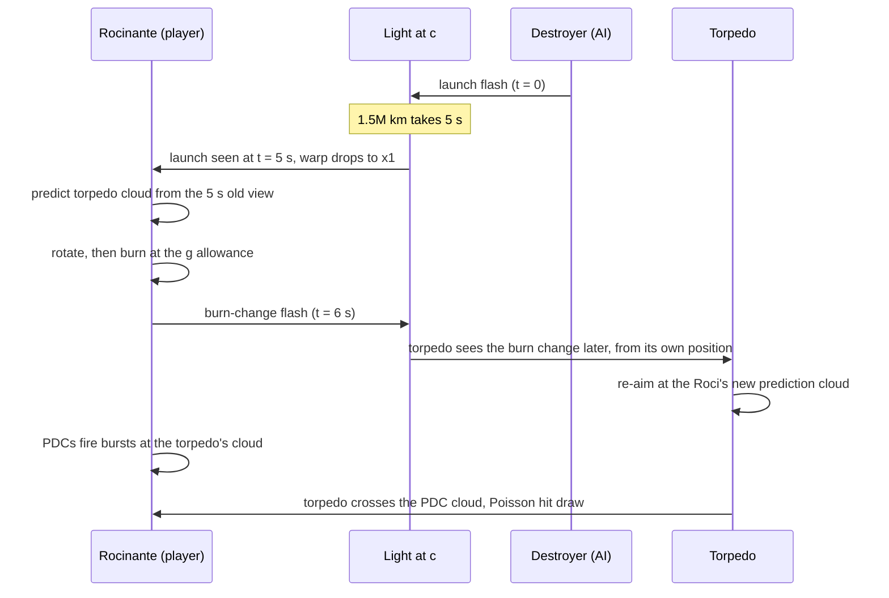
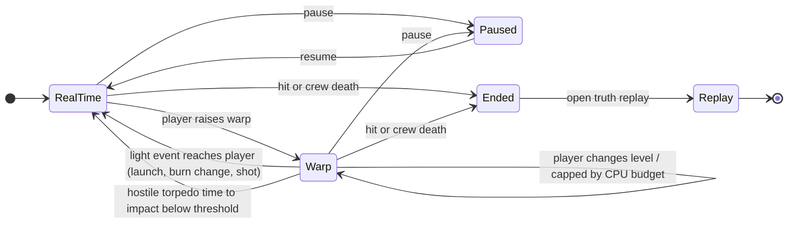

# Diagrams

## Sequence Diagrams
Light carries every piece of information between ships. Nobody acts on the present.

<sub>Light-Delayed Engagement Sequence</sub>



## Pseudocode
One fixed game-time step. Warp only changes how many of these run per real second.

<sub>Simulation Step Pseudocode</sub>

```diff
+ step(dt):
+   for each observer (ships, torpedoes):
+     observations := retarded-time view of every other emitter
+     orders := autopilot / AI / guidance from observations and prediction clouds only
+   apply orders: thruster torque, main drive thrust (capped by g allowance), weapon fire
+   integrate every rigid body, slug and cloud centroid by dt; burn reaction mass
+   add equal and opposite impulse for every shot fired
+   swept collision of slugs and torpedoes against oriented boxes over [t, t+dt]
+   for every object crossing a PDC cloud: hits ~ Poisson(column density x silhouette)
+   accumulate crew g-dose and draw crew death
+   emit flashes (launch, burn change, shot) into the light-event history
+   record state history for retarded-time lookups and the truth replay
+   check end conditions
```

## State Machine
How time warp reacts to what reaches the player.

<sub>Time Warp State Machine</sub>



## Contracts
- **Invariant:** no observer-facing logic reads another object's true current state. Only the truth replay is all-seeing.
- **Invariant:** the same seed and orders produce identical events at any warp level.
- **Invariant:** prediction clouds are drawn at their true size.
- **Boundary:** nothing changes heading without torque or velocity without thrust or impulse.
- **Boundary:** no fast object passes through another between steps.
- **Postcondition of firing:** the shooter's momentum changes by minus the projectile's momentum.

## Glossary
* ghost - A contact drawn where its light left it, labelled with that light's age
* retarded time - The moment light now arriving from an object left it
* flash - A light-speed event (launch, burn change, shot) that observers see once it reaches them
* prediction cloud - The weighted set of places a contact could be at a given time, from simulating possible maneuvers
* PDC cloud - The spreading group of rounds from one PDC burst, treated as a density of rounds per m²
* g-dose - A crew's accumulated exposure to acceleration, which sets its chance of death
* g allowance - The most acceleration the player lets the autopilot use
